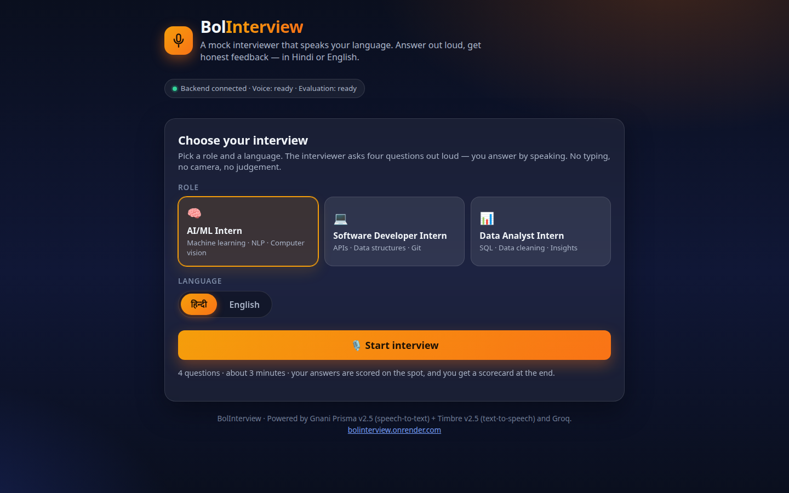

# BolInterview 🎙️

A voice mock-interviewer for internship candidates — built for the
**Gnani Great Indian AI Internship Challenge 2026**.

Pick a role and a language, then do a 4-question spoken mock interview:
each question is spoken aloud, you answer by voice, an LLM evaluates the
answer and gives short spoken feedback, and at the end you get a scorecard
(per-question scores + overall + improvement tips) that is shown and spoken.

Built for Hindi-medium students who know their subject but freeze in
interviews — the whole interview happens by voice, in Hindi or English.

🌐 **Live demo:** https://bolinterview.onrender.com/

## Screenshots



## Stack

- **Speech-to-text:** Gnani Prisma v2.5 (REST, `gnani-vachana` SDK)
- **Text-to-speech:** Gnani Timbre v2.5 — Nalini (Hindi), Kaveri (English)
- **Evaluation:** Groq `openai/gpt-oss-120b`
- **Backend:** FastAPI, one service; the frontend is a single static page
  served by the same app (no separate frontend deploy)

## Run locally

```bash
python -m venv .venv && source .venv/bin/activate
pip install -r requirements.txt
cp .env.example .env   # then fill in your keys (never commit .env)
uvicorn app.main:app --port 8000
# open http://localhost:8000
```

## Environment variables

| Variable | Purpose |
| --- | --- |
| `GNANI_API_KEY` | Gnani API key (Prisma STT + Timbre TTS). Required for interviews. |
| `GROQ_API_KEY` | Groq API key for answer evaluation. Without it, answers are recorded and transcribed, but no score is invented — the scorecard shows "not scored". |

## Demo flow

1. Pick a role (AI/ML Intern, Software Developer Intern, Data Analyst Intern)
   and a language (Hindi / English), press **Start interview**.
2. The interviewer speaks question 1. Press **Record your answer**, speak,
   press **Stop**. Your transcript, score (0–10) and spoken feedback appear.
3. Repeat for questions 2–4. After the 4th answer the scorecard appears
   with the overall score, strengths, improvements — and a spoken summary.

## API

| Method | Path | Description |
| --- | --- | --- |
| GET | `/` | Frontend |
| GET | `/api/health` | Status + which keys are configured |
| GET | `/api/roles` | Roles + languages |
| POST | `/api/interview/start` | `{role, language}` → first spoken question |
| POST | `/api/interview/answer` | multipart `audio` + `session_id` → transcript, score, spoken feedback, next question or scorecard |
| GET | `/api/interview/scorecard/{session_id}` | Stored scorecard for a finished session |

Errors: unknown session 404, empty/oversized audio (> 5 MB) 400,
empty transcript 400 ("No speech detected"), missing `GNANI_API_KEY` 503.

## Audio format — read this

Prisma REST **rejects webm** (verified live: HTTP 400
`UNSUPPORTED_AUDIO_FORMAT`; supported: ogg, aac, mp3, flac, wav, m4a).
The frontend records with `MediaRecorder` mimeType `audio/mp4` (file
`clip.m4a`), falling back to `audio/ogg;codecs=opus` (`clip.ogg`).
Never send webm.

## Credit budget per session

One 4-question interview uses **13 short Gnani calls**:
4 question TTS + 4 answer STT + 4 feedback TTS + 1 summary TTS.
Every spoken line is kept short (questions under ~25 words, feedback
1–2 sentences, summary under ~60 words). Keep demo sessions to one
full run each.

## Tests

```bash
pytest tests/   # 15 tests, all Gnani + Groq calls mocked — zero live calls
```

## Deploy (Render)

1. Create a GitHub repo and push this code.
2. Create a Render Web Service from the repo (Docker runtime, free tier).
3. Set environment variables `GNANI_API_KEY` and `GROQ_API_KEY`.
4. Open the service URL and run one full interview to verify live.
